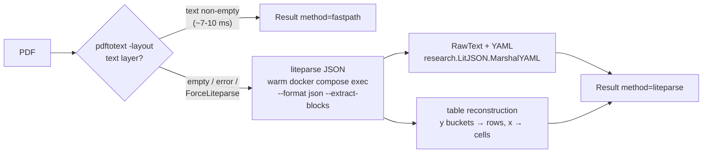

# PoC: hybrid docpipe handler — pdftotext + liteparse JSON + tables by geometry (issue #223)

Subtask of epic [#219](https://git.produktor.io/eSlider/2dph/issues/219)
(structural document extraction). Develops the A/B conclusion from
[docs/research-liteparse.md](docs/research-liteparse.md): **not a replacement but a
hybrid** — the pdftotext fast path for the text layer, liteparse JSON for
complex/scans, table reconstruction from `text_items` (geometry), because
neither of the base paths recognizes a table as a structure.

Package: `internal/docpipe/` (next to `internal/ocr`, which is untouched). The production
corpus `var/corpus` was not touched; everything is `var/research/` (gitignored) +
`internal/docpipe/` + this report.

## How the handler works

API (`internal/docpipe`):

- `Handle(ctx, path, Opts) (*Result, error)` — the hybrid run.
- `ReconstructTables(pages, URLBase) []Table` — reconstruction by geometry
  (a separately callable, pure function).
- `Opts{ForceLiteparse, OCR, Base, LitParser, PDFToText}` — hooks for tests and
  for forcing the structural path (scans).
- `Result{Method, Text, JSON, YAML, Tables, FastPathMs, LiteparseMs}`.

Hybrid rules:

1. First the fast path (`pdftotext -layout`, like `internal/ocr.PDFFile`).
   Non-empty text → the result, `method=fastpath`.
2. Fast path empty / error / `ForceLiteparse` → call the warm service via
   `internal/research.Runner` (`docker compose exec -T liteparse lit parse
   /v/<rel>.pdf --format json --extract-blocks --no-ocr [-o OCR]`). `--no-ocr`
   by default; `Opts.OCR` enables tesseract (scans).
3. JSON→YAML — `research.LitJSON.MarshalYAML` (single implementation, yaml.v3
   with explicit tags; there is no local converter).
4. Tables are reconstructed only on the liteparse path — pdftotext has no
   geometry.

The docker dependency is isolated: `LitParser` is an interface (satisfied by
`*research.Runner`), `PDFToText` is a function. Offline tests
substitute both; the live run is under the build tag `research_docpipe`.

## Table reconstruction (algorithm)

`text_items` are positioned fragments (bbox + font). A table is rebuilt by geometry:

1. The y-bucket threshold = **half the median font_size** of the page (floor 2pt).
2. Sort items by y (then x, then text — for determinism). Items whose y
   differs from the bucket anchor by no more than the threshold are one
   visual row.
3. Inside a row cells are sorted by x (left to right).
4. **A table row = ≥2 cells.** A table = the maximal consecutive run
   of multi-cell rows (at least 2 rows). Single-cell rows (the document
   heading, a note) do not get into the table.
5. Every node gets a URL in the spirit of #100:
   `docpipe://pdf/<sha256[:16]>/doc/page[0]/table[0]/tr[1]/td[2]` (built by
   `internal/address.New`).

### bbox scope (real invoices) + wrapping join

When liteparse detects `kind: table` **with a bbox** (tables with borders —
real invoices/contracts), each table is reconstructed **only from the
text_items inside its bbox**: this separates neighbouring tables from each other and does not
let wrapped lines leak into foreign buckets. The fallback is the whole page
split into runs.

Wrapped lines inside a cell (LibreOffice/Pandoc, "Consulting" /
"services") are joined: a single-cell row whose first cell falls into the
x-interval of a cell of the previous row is added to that cell.

### Result on invoice-text (synthetic invoice, fixture #220)

`text_items` (14 items) → 7 y-buckets: `INVOICE-7C2F9E` · `Client: Acme GmbH` ·
`Item|Qty|Price` · `Widget A|2|10.00` · `Widget B|1|25.00` · `Total|45.00` ·
`Note: net 14 days.`. The table = a run of 4 rows:

| tr | Cells |
|----|--------|
| 0 | Item · Qty · Price |
| 1 | Widget A · 2 · 10.00 |
| 2 | Widget B · 1 · 25.00 |
| 3 | Total · 45.00 |

The document heading, the client line and the note stayed outside the table
(single-cell). PoC limitation: a cell = one `text_item` (joining cells broken
into several items is the next step; in invoices this is rare).

### Result on invoice-bill (a real invoice with borders, 2026-08-30)

New sample `var/research/samples/invoice-bill.pdf` (an Acme GmbH invoice,
generated pandoc → docx → LibreOffice PDF) — **liteparse recognizes
2 tables as `kind: table`** (with bbox). Reconstruction by bbox:

| Table | tr | Cells |
|---------|----|--------|
| Items (t0) | 0 | `#` · `n` · `Qty` · `Unit Price` · `Amount` |
| | 1 | `1` · `Consulting services` · `10` · `120.00` · `1200.00` |
| | 2 | `2` · `Software license` · `2` · `450.00` · `900.00` |
| | 3 | `3` · `Support (annual)` · `1` · `300.00` · `300.00` |
| Totals (t1) | 0 | `Item` · `Amount` |
| | 1 | `Subtotal` · `2400.00` |
| | 2 | `VAT (19%)` · `456.00` |
| | 3 | `Total Due` · `2856.00` |

Wraps are joined (`Consulting services`, `Software license`); the totals are extracted
programmatically (`Total Due` → `2856.00`). A detail: the column heading "Description"
is truncated to `n` ("Descriptio" lies above the table bbox) — the data is not affected.

## Tests (TDD, offline)

`internal/docpipe/docpipe_test.go` — no network/docker/model; the text_items fixture
is generated in the test from the values in
`var/struct-data/<sha256(invoice-text.pdf)>.yml`:

- the invoice-text table is recognized as a structure (4 rows, exact cells,
  single-cell rows do not leak);
- URL addressing: `page[0]/table[0]`, `tr[1]`, `tr[1]/td[2]`;
- y-buckets: 7 rows, gap 20pt > threshold 5.5 → different buckets;
- no multi-cell rows → no tables;
- fast path: a real text-layer PDF (generated in the test, correct xref)
  → `method=fastpath`, the liteparse hook is not called (skipped if pdftotext
  is missing from PATH);
- fallback: fast path empty → liteparse hook → tables + YAML;
- `ForceLiteparse` bypasses the fast path; both paths fail → an error with both
  causes.

The `internal/research` JSON→YAML converter is already covered by its own tests — we did not
duplicate it, the handler only imports it.

## Run on a real sample (warm service, 2026-08-30)

`go test -tags=research_docpipe -run TestLive -v ./internal/docpipe/ -count=5`
— invoice-text.pdf through both paths (docker compose exec, the `liteparse` service
healthy):

| Path | ms (5 runs) | p50 | p95 | Result |
|------|-----------------|-----|-----|-----------|
| fast path (pdftotext -layout) | 6.4 / 8.6 / 7.7 / 8.4 / 6.4 | 7.7 | 10.1 | text, columns preserved |
| liteparse JSON (warm) + tables | 124.0 / 109.6 / 103.1 / 121.5 / 122.5 | 121.5 | 127.8 | 1 table, 4 rows, cells exact |

**The table is recognized**: `Item|Qty|Price`, `Widget A|2|10.00`,
`Widget B|1|25.00`, `Total|45.00` — a structure with URLs, not smeared
text. The invoice total is extracted programmatically (`table[0]/tr[3]/td[1]` = `45.00`).

**The real invoice** `invoice-bill.pdf` (bbox path, warm service): liteparse
~105 ms, **2 tables** (Items + Totals), wraps joined, `Total Due` =
`2856.00` (verified by the live test `TestLiveBillTables`).

The fast path on this document is ~15x faster than liteparse; the daemon pattern
(#226) keeps liteparse at ~110-130 ms against ~700 ms for the old `docker run`.

## Selection threshold (fast path vs liteparse)

- **The fast path always wins when there is a text layer**: an order of magnitude faster
  and it preserves columns in the text. `pdftotext` failed/empty → liteparse.
- **Liteparse is needed when structure/geometry is needed** (tables, bbox,
  invoice field extraction) or the document is a scan/complex:
  - the verdict `lit is-complex` — with caution: `sparse-text` on a small
    text-layer invoice is a false positive (#221), so the PoC by default
    does not trust the verdict but relies on the fast path being empty;
  - `invoice-scan.pdf` — pdftotext returns a non-empty garbage run
    (`SCAN-9F31A1`) → for scans force `ForceLiteparse + OCR`;
  - structural queries (tables/fields) — `ForceLiteparse` deliberately.

## Integration into mailconv/etl (#96/#98)

- `internal/mailconv/handlers.go` — `pdfHandler` is currently = `ocr.PDFFile`.
  The hybrid takes its place: `pdfHandler → docpipe.Handle` (the fast path returns the same
  pdftotext text as today), the liteparse branch only on demand
  (scan/structure), so as not to add 120 ms to every PDF attachment.
- `internal/etl` Registry (`#96`) — a handler per MIME; docpipe is a candidate for the
  `application/pdf` handler, where `Result` → typed `Meta` + `Text` +
  lazy `Children`, and `Tables` are granular Item nodes (#100): each cell is a
  node with a URL and the content `sha256`, links between parts only by URL.
- Separation of responsibility: `internal/ocr` (tesseract/gs normalization)
  stays as the fallback for export-protected PDFs; docpipe is the structural
  path. The decision on replacing `ocr.PDFFile` is later, outside the PoC scope (#223).

## Conclusion

**The handler is ready for integration** into mailconv/etl as an optional structural
path: offline tests are green (`go test -race ./internal/docpipe/...`), the live run
recognizes the synthetic invoice table via the warm service, the metrics are within
expectations (#221: ~7-10 ms fast, ~110-130 ms warm liteparse). PoC limitations:
a cell = one `text_item` (no joining of broken ones), the threshold is half the
median font_size (no adaptation to multi-font pages), the path choice
is not automated via the verdict (an accurate threshold based on the #221 findings is needed).
Next steps of epic #219: joining broken items, a run over the real
corpus, integrating docpipe into the etl registry.
